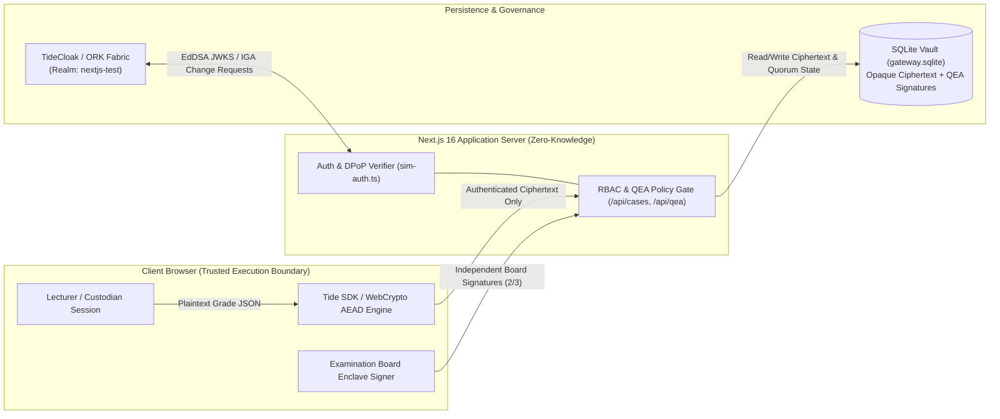

# TideGrade — Zero-Knowledge & Quorum-Governed Academic Grade Custody Platform

> **RMIT Hackathon 2026 · Challenge 2 (Tide UNLOCKED)**  
> **Team:** `RMIT_SGS_NewAIEra_C2`  
> *"Tamper-proof exam grades: zero-knowledge storage, cryptographic client-side E2EE, and 2-of-3 quorum-enforced governance."*


-2ea44f)

---

## 1. Executive Summary

Academic institutions and national examination boards face a critical security vulnerability: **privileged insider threats and database-level tampering**. In conventional identity and access management (IAM) architectures, a single compromised administrator account, rogue database administrator (DBA), or breached application server can silently read or alter finalized student grades.

**TideGrade** eliminates unilateral administrative trust by combining **TideCloak Identity Governance & Administration (IGA / QEA)**, **Client-Side End-to-End Encryption (E2EE)**, and **Sender-Constrained Tokens (DPoP, RFC 9449)**:

1. **Client-Side Hermetic E2EE (`_tide_case001.selfencrypt` / `_tide_case001.selfdecrypt`):** Grade records are encrypted directly inside the examiner's browser before transmission. The Next.js backend and SQLite persistence layer operate as a **Zero-Knowledge Vault**, storing only opaque authenticated ciphertext.
2. **2-of-3 Quorum-Enforced Authorization (Tide QEA):** No single administrator can grant decryption privileges or unseal a finalized grade record. Granting the `_tide_case001.selfdecrypt` role requires an independent **2-of-3 multi-admin quorum** (`N = 3, Threshold = 2`) with strict **Four-Eyes policy enforcement**.
3. **Cryptographic Tamper Detection (AEAD Integrity):** Any direct modification of stored ciphertext inside SQLite by a malicious DBA or SQL injection attack invalidates the authenticated encryption tag, causing client-side decryption to fail closed immediately.
4. **Sender-Constrained API Verification (EdDSA JWT + DPoP):** All API endpoints enforce server-side verification of TideCloak EdDSA signatures, DPoP proof bindings (`cnf.jkt`), and fine-grained role claims, plus an ORK-resilient simulation layer designed via **Tide Raziel MCP**.

---

## 2. System Architecture & Trust Boundaries



| Boundary Layer | Responsibility | Trust Assumption |
| :--- | :--- | :--- |
| **1. Client Browser** | Performs Tide authentication, DPoP proof generation, client-side E2EE sealing, and browser-only decryption. | Plaintext grades exist strictly in volatile browser memory during authorized sealing or unsealing. |
| **2. Next.js 16 API** | Validates DPoP-bound tokens, enforces `_tide_case001.*` and `tide-realm-admin` role checks, and verifies 2-of-3 QEA quorum state. | Untrusted with plaintext keys; never holds decryption material or bypass shortcuts. |
| **3. SQLite Storage** | Persists case metadata, opaque E2EE ciphertext blobs, appeal audit logs, and cryptographic QEA approval records. | Compromising the database file (`app-data/gateway.sqlite`) yields zero plaintext grades; tampering breaks AEAD verification. |
| **4. TideCloak & QEA** | Governs identity lifecycle and role assignments (`GRANT_ROLES`) under a 2-of-3 multi-admin threshold (`N = 3, T = 2`). | Prevents any single administrator from unilaterally escalating privileges. |

---

## 3. Governance & Role Matrix

TideGrade enforces strict separation of duties across four cryptographic identities:

| Actor Identifier | Organizational Role | Initial TideCloak Roles | Governance & Access Capabilities |
| :--- | :--- | :--- | :--- |
| `custodian-demo` | Lecturer / Student Custodian | `_tide_case001.selfencrypt`, `appUser` | Can encrypt and seal grade records (`PUT /api/cases/case-001/evidence`). Blocked with `403 Forbidden` from decrypting until `2/3` QEA Quorum commits `_tide_case001.selfdecrypt`. |
| `admin-a` | Examination Board Member (1/3) | `tide-realm-admin`, `_tide_case001.selfencrypt` | Can authorize QEA Change Requests (`1/2 PENDING`). Blocked by Four-Eyes policy (`409 Conflict`) from signing the same request twice. |
| `reviewer-b` | Dean of School (2/3) | `tide-realm-admin`, `appUser` | Independent approver. Providing the 2nd signature reaches `2/2 COMMITTED` quorum and automatically provisions `_tide_case001.selfdecrypt`. |
| `reviewer-c` | Independent Academic Auditor (3/3) | `tide-realm-admin`, `appUser` | Reserve governance member maintaining `N = 3` (`Threshold = 2`) fault tolerance. |

---

## 4. API Specification

All API routes are protected by server-side authentication and role verification ([`lib/server/sim-auth.ts`](lib/server/sim-auth.ts)):

| Method & Endpoint | Description | Access Control & Governance Policy |
| :--- | :--- | :--- |
| `GET /api/cases` | Lists academic grade cases and current E2EE seal status (`sealed: boolean`). | Valid Tide session / DPoP proof. |
| `PUT /api/cases/case-001/evidence` | Stores browser-encrypted E2EE ciphertext for `case-001` once. | Requires `_tide_case001.selfencrypt`. Rejects plaintext or duplicate seals (`409`). |
| `GET /api/cases/case-001/evidence` | Returns sealed ciphertext for client-side decryption. | Requires `_tide_case001.selfdecrypt` (returns `403 Forbidden` when QEA Quorum is `0/2` or `1/2`). |
| `DELETE /api/cases/case-001/evidence` | Resets sealed evidence, appeal requests, and QEA quorum state (`0/2`). | Authenticated session (sandbox reset endpoint). |
| `GET /api/qea` | Returns current QEA Change Request status (`PENDING` vs `COMMITTED`), approval count, and active principal claims. | Valid Tide session / DPoP proof. |
| `POST /api/qea` | Records an enclave approval signature on Change Request `cr-qea-case001-selfdecrypt`. | Requires `tide-realm-admin`. Enforces Four-Eyes uniqueness (`409`) and auto-commits at `2/2` approvals. |
| `GET /api/requests` | Retrieves submitted grade appeal requests. | Valid Tide session / DPoP proof. |
| `POST /api/requests` | Logs a formal grade review/appeal request (`{ caseId, purpose }`). | Requires `case-001` to be sealed prior to appeal. |
| `GET /api/audit` | Returns raw SQLite table snapshots (`cases`, `evidence`, `requests`, `qeaApprovals`) for zero-knowledge auditing. | Valid Tide session / DPoP proof. |
| `POST /api/audit` | Executes red-team tamper simulation (`{ action: "tamper" }`) against stored SQLite ciphertext. | Valid Tide session / DPoP proof. |

---

## 5. Project Structure

```text
├── app/
│   ├── api/
│   │   ├── audit/route.ts                     # Raw SQLite inspector & ciphertext tamper simulator
│   │   ├── cases/route.ts                     # Case metadata & seal status endpoint
│   │   ├── cases/[id]/evidence/route.ts       # E2EE ciphertext storage & quorum-gated retrieval
│   │   ├── me/route.ts                        # Verified principal & role inspection endpoint
│   │   ├── qea/route.ts                       # 2-of-3 Multi-Admin QEA Quorum authorization engine
│   │   └── requests/route.ts                  # Academic grade appeal audit trail endpoint
│   ├── auth/redirect/page.tsx                 # OIDC authorization code & DPoP callback handler
│   ├── home/page.tsx                          # Unified 3-tab enterprise console (Portal, QEA Quorum, Red-Team Sandbox)
│   ├── tide_dpop/[...path]/route.ts           # DPoP enclave relay route with CSP embedded enforcement headers
│   ├── globals.css                            # Enterprise dark UI design system
│   ├── layout.tsx                             # Root layout with TideCloakProvider (strict DPoP mode)
│   └── page.tsx                               # Landing page with live OIDC & simulated TideCloak identity selector
├── lib/
│   ├── server/
│   │   ├── sim-auth.ts                        # Hybrid TideCloak EdDSA + DPoP verifier & simulated RBAC/QEA resolver
│   │   └── sim-db.ts                          # Node 24 native SQLite persistence & QEA quorum state machine
│   └── verify-dpop.ts                         # RFC 9449 DPoP proof signature, htm/htu, and cnf.jkt verifier
├── init/
│   └── realm.json                             # TideCloak realm initialization template (nextjs-test)
├── public/
│   ├── silent-check-sso.html                  # OIDC silent token refresh iframe asset
│   └── tide_dpop_auth.html                    # Tide DPoP enclave authentication relay asset
└── tidecloak.json                             # Exported TideCloak adapter configuration (EdDSA VVK JWKS)
```

---

## 6. Getting Started

### Prerequisites
- **Node.js** `v22.x` or `v24.x` (uses built-in `node:sqlite`)
- **Docker** *(optional — only required if connecting to a local TideCloak container on port `8080`; the application includes a built-in ORK-resilient TideCloak simulation mode for offline/high-load environments)*

### Installation & Local Development

```bash
# 1. Install dependencies
npm ci

# 2. Start the Next.js development server on port 3000
npm run dev
```

Open **`http://localhost:3000`** in your browser.

### Verification & Type Checking

```bash
npx tsc --noEmit
```

---

## 7. Team & Acknowledgments

- **Team Name:** `RMIT_SGS_NewAIEra_C2`
- **Track:** RMIT Hackathon 2026 — Challenge 2 (*Tide UNLOCKED*)
- **Technology Stack:** Next.js 16, React 19, TypeScript, Node.js `node:sqlite`, WebCrypto AEAD (`AES-256-GCM`), `@tidecloak/nextjs`, and Tide Raziel MCP.
